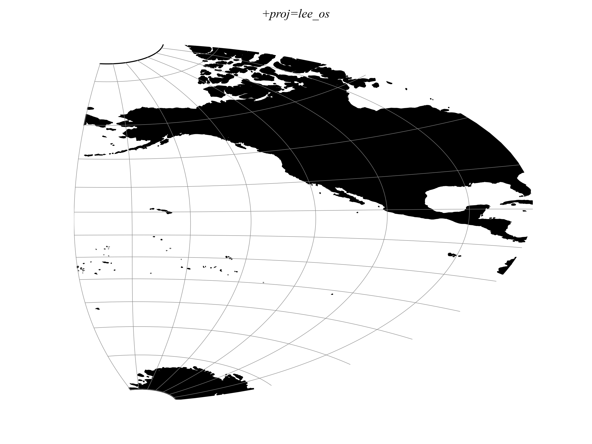

.. _lee_os:

********************************************************************************
Lee Oblated Stereographic
********************************************************************************

+---------------------+----------------------------------------------------------+
| **Classification**  | Azimuthal                                                |
+---------------------+----------------------------------------------------------+
| **Available forms** | Forward and inverse, spherical only                      |
+---------------------+----------------------------------------------------------+
| **Defined area**    | Global                                                   |
+---------------------+----------------------------------------------------------+
| **Alias**           | lee_os                                                   |
+---------------------+----------------------------------------------------------+
| **Domain**          | 2D                                                       |
+---------------------+----------------------------------------------------------+
| **Input type**      | Geodetic coordinates                                     |
+---------------------+----------------------------------------------------------+
| **Output type**     | Projected coordinates                                    |
+---------------------+----------------------------------------------------------+

   proj-string: ``+proj=lee_os``

Parameters
################################################################################

.. note:: All parameters are optional for the projection.

The projection uses a sphere with the semi-major axis of the specified ellipsoid
as its radius. The eccentricity of the ellipsoid is ignored.

.. include:: ../options/ellps.rst

.. include:: ../options/R.rst

.. include:: ../options/x_0.rst

.. include:: ../options/y_0.rst
